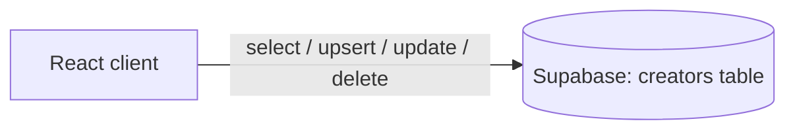

<div align="center">

# Creatorverse

A React app for keeping a list of favorite content creators, with full create, read, update and delete support backed by Supabase.


</div>

> Prework project for CodePath's **WEB103: Intermediate Web Development** course. Submitted by Abhishek Yadav. Time spent: about 4 hours.

## Overview

Creatorverse stores content creators (people on YouTube, Instagram, Twitter, Twitch, TikTok and similar platforms) in a Supabase `creators` table. The React client lists them as cards, shows a detail view per creator, and provides forms to add, edit and delete entries. All data access goes directly from the browser to Supabase with `async`/`await`.

## Features

- **Creator cards**: the home page loads every row from `creators`, ordered by `created_at`, and renders an image, name, description and social icons.
- **Detail view**: `/:id` shows the creator's image, name, description and links to their YouTube, Instagram and Twitter profiles, built from the stored handles.
- **Add creator**: `/new` is a form for name, description, optional image URL and social handles, saved with `upsert`.
- **Edit and delete**: `/edit/:id` pre-fills the form, saves changes with `update`, and removes the creator with `delete`.
- **Tooltips and icons**: `react-tooltip` labels the info and edit actions, and `react-icons` provides the platform icons.

## Tech stack

| Layer | Technology |
| --- | --- |
| UI | React 18, React Router (`useRoutes`) |
| Styling | Pico CSS, Font Awesome, custom CSS |
| Data | Supabase (`@supabase/supabase-js`) |
| UI helpers | `react-icons`, `react-tooltip`, `react-confirm-alert` |
| Tooling | Vite 4, ESLint |

## Architecture



## Project structure

```text
.
├── client.js                     # Supabase client setup
├── index.html
├── vite.config.js
└── src/
    ├── main.jsx                  # BrowserRouter + App
    ├── App.jsx                   # data loading, routes, header
    ├── pages/
    │   ├── ShowCreators.jsx
    │   ├── ViewCreator.jsx
    │   ├── AddCreator.jsx
    │   ├── EditCreator.jsx
    │   └── HomePage.jsx          # unused
    └── components/
        ├── ContentCreatorCard.jsx
        └── ConfirmDeleteDialog.jsx
```

## Getting started

### Prerequisites

- Node.js and npm
- A Supabase project with a `creators` table containing `id`, `created_at`, `name`, `description`, `imageURL`, `youtube`, `instagram` and `twitter` columns

### Install and run

```bash
npm install
npm install @supabase/supabase-js react-router-dom   # imported but not listed in package.json
npm run dev
```

Other scripts: `npm run build`, `npm run preview`, `npm run lint`.

### Configure

`client.js` creates the Supabase client from a project URL and anon key written directly in the file. Point it at your own project, ideally by reading Vite environment variables such as `VITE_SUPABASE_URL` and `VITE_SUPABASE_ANON_KEY` instead of committing the values.

## Course checklist

**Required features**

- [x] A logical component structure in React is used to create the frontend of the app
- [x] At least five content creators are displayed on the homepage of the app
- [x] Each content creator item includes their name, a link to their channel/page, and a short description of their content
- [x] API calls use the async/await design pattern via Axios or `fetch()`
- [x] Clicking on a content creator item takes the user to their details page, which includes their name, URL and description
- [x] Each content creator has their own unique URL
- [x] The user can edit a content creator to change their name, URL or description
- [x] The user can delete a content creator
- [x] The user can add a new content creator by entering a name, URL or description, and it is then displayed on the homepage

**Optional features**

- [x] Pico CSS is used to style HTML elements
- [x] The content creator items are displayed in a creative format, like cards instead of a list
- [x] An image of each content creator is shown on their content creator card

## Walkthrough


## Notes and limitations

- The Supabase URL and anon key are hardcoded in `client.js`. Anyone with the repo can use them, so rotate the key and enable row-level security on the table.
- `AddCreator.jsx` uses `useHistory`, a React Router v5 API, while the rest of the app uses v6 (`useRoutes`, `useNavigate`). Switch to `useNavigate` when upgrading.
- The detail and edit pages read the creator from in-memory state set when a card is clicked, so opening `/:id` or `/edit/:id` directly shows an empty view.
- `ConfirmDeleteDialog` exists but is not wired in; Delete runs immediately.
- The author's note: this was done during the last week of a summer internship, so time was tight, and connecting the database took some troubleshooting.

---

Built by [Abhishek Yadav](https://github.com/abhiishek340)
